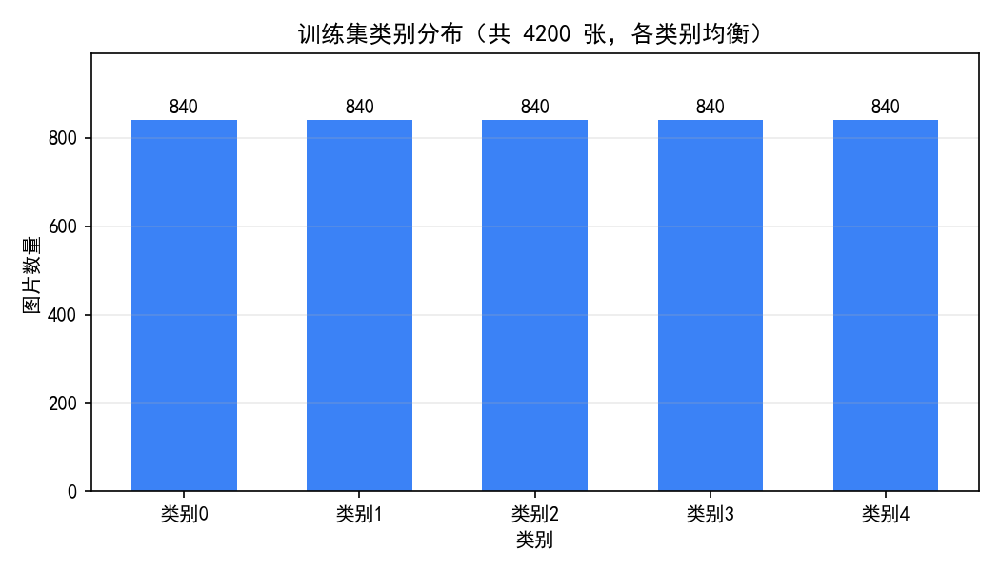
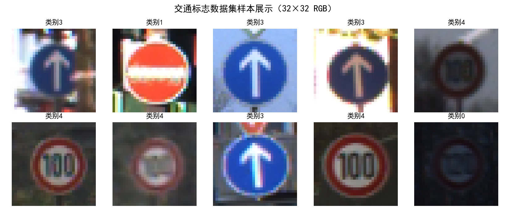
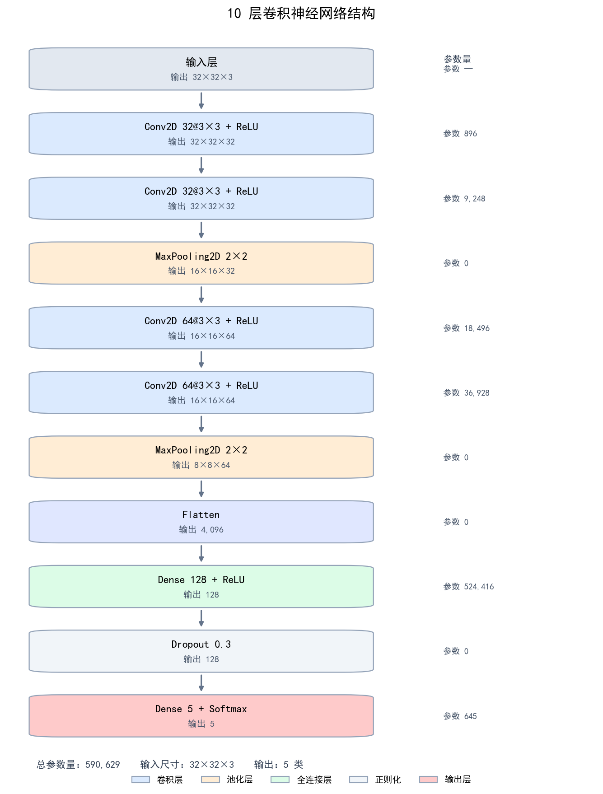
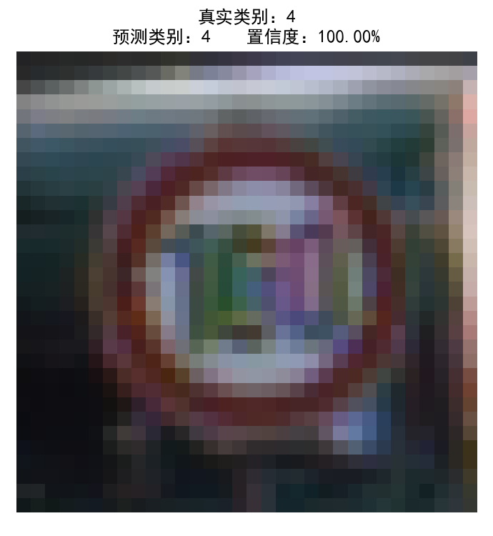
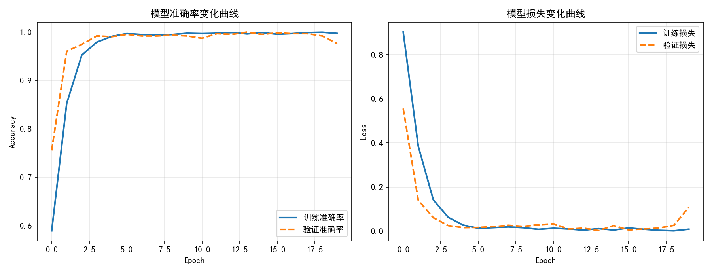
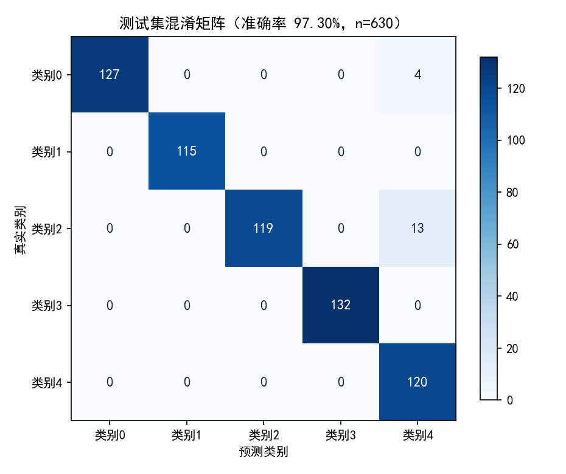

# 基于卷积神经网络的交通标志识别

使用 TensorFlow 构建 10 层卷积神经网络（CNN），在纯 CPU 环境下完成 5 类交通标志图像的分类识别。项目覆盖数据加载与划分、图像归一化、模型构建、训练可视化、测试评估与单样本预测的完整流程，并针对无独立显卡的笔记本电脑做了系统性的 CPU 性能优化。

**实测结果：测试集准确率 97.30%，20 个 Epoch 完整运行约 107 秒（Intel i5-8365U，16GB 内存，无独立显卡）。**

## 目录

- [项目简介](#项目简介)
- [功能特性](#功能特性)
- [数据集说明](#数据集说明)
- [技术架构](#技术架构)
- [项目结构](#项目结构)
- [环境要求与安装](#环境要求与安装)
- [使用指南](#使用指南)
- [功能演示](#功能演示)
- [实验结果](#实验结果)
- [核心实现](#核心实现)
- [常见问题](#常见问题)
- [改进方向](#改进方向)
- [参考资料](#参考资料)

## 项目简介

交通标志识别是智能交通系统和辅助驾驶中的基础视觉任务。本项目将其建模为图像分类问题：

- **输入**：32×32 像素的 RGB 交通标志图像；
- **输出**：5 个类别（类别 0–4）的概率分布；
- **模型**：4 个卷积层 + 2 个最大池化层 + 展平层 + 全连接层 + Dropout + Softmax 输出层，共 10 层；
- **训练环境**：Windows + Python 3.12 + TensorFlow 2.21.0，纯 CPU 训练，无需 GPU。

项目代码集中在单文件 [`Traffic.py`](Traffic.py) 中，结构清晰，便于课程实验演示、二次开发和迁移到其他小尺寸图像分类任务。

## 功能特性

- **自动数据划分**：从训练目录按 7:3 划分训练集与临时验证集，再从临时验证集中对半划分验证集与测试集；训练/验证使用相同随机种子，保证划分互补且类别分布均衡。
- **高效数据流水线**：`cache` 将解码后的图片常驻内存，`shuffle` 每个 Epoch 全量打乱样本，`prefetch` 让数据准备与模型计算重叠。
- **10 层 CNN**：卷积层提取边缘、纹理特征，池化层逐级降维，Dropout 缓解过拟合，Softmax 输出类别概率。
- **完整可视化**：数据集类别分布、样本展示、训练准确率/损失曲线、测试集混淆矩阵、单样本预测结果。
- **CPU 专项优化**：启用 oneDNN、按物理核心配置线程、内存缓存、批量大小调优，训练速度相比原始实现提升约 2 倍。
- **可复现**：固定随机种子（123），记录实验指标与训练历史。
- **易运行**：支持命令行、VS Code、Spyder 等环境，无需 GPU。

## 数据集说明

数据集为 5 类交通标志图像，统一读取为 32×32 的 RGB 图像。图片按类别存放在 `0`–`4` 五个子目录中，目录名即类别标签，可直接被 `tf.keras.utils.image_dataset_from_directory` 解析。


| 数据目录      | 图片数量 | 类别分布       | 说明                               |
| ------------- | -------: | -------------- | ---------------------------------- |
| `train/`      |    4,200 | 5 类 × 840 张 | 主训练数据，代码按 7:3 自动划分    |
| `validation/` |      600 | 5 类 × 120 张 | 预留的独立验证数据，当前代码未使用 |
| `test/`       |      100 | 无类别子目录   | 未标注图片，可用于人工推理演示     |

代码实际使用的数据划分：


| 子集   | 图片数量 | 用途                       |
| ------ | -------: | -------------------------- |
| 训练集 |    2,940 | 参数更新                   |
| 验证集 |      630 | 每个 Epoch 监控泛化能力    |
| 测试集 |      630 | 最终性能评估（仅使用一次） |



_训练集共 4,200 张图片，5 个类别各 840 张，类别分布完全均衡。_



_训练集随机样本，包含限速、禁令、直行等交通标志，图像分辨率较低且背景复杂。_

> 说明：当前代码只使用 `train/` 进行自动划分，`validation/` 与 `test/` 目录未被读取。如需使用独立验证集，可将 `data_root` 分别指向对应目录并调整数据加载逻辑。

### 数据划分的规范性

原始实现中训练子集使用 `shuffle=True`、验证子集使用 `shuffle=False`，两次划分结果并不互补：验证/测试数据会按类别排序截取，只覆盖部分类别，且可能与训练集重叠，导致评估结果虚高。本项目已改为**两个子集使用相同的 `shuffle=True` 和 `seed=123`**，保证划分严格互补、各类别均匀分布，测试集准确率能够真实反映 5 类分类性能。

## 技术架构

### 技术栈


| 类别         | 技术 / 版本                                          |
| ------------ | ---------------------------------------------------- |
| 编程语言     | Python 3.12.12                                       |
| 深度学习框架 | TensorFlow 2.21.0（Keras 3）                         |
| CPU 加速库   | oneDNN（TensorFlow 内置）                            |
| 数值计算     | NumPy                                                |
| 可视化       | Matplotlib                                           |
| 开发环境     | Spyder / VS Code / 命令行                            |
| 硬件环境     | Intel i5-8365U（4 核 8 线程）、16GB 内存、无独立显卡 |

### 模型结构

模型共 10 层（不含输入层），参数量 590,629。


| 序号 | 层类型       | 配置                               | 输出尺寸   |  参数量 |
| ---: | ------------ | ---------------------------------- | ---------- | ------: |
|    1 | Conv2D       | 32 个 3×3 卷积核，same 填充，ReLU | 32×32×32 |     896 |
|    2 | Conv2D       | 32 个 3×3 卷积核，same 填充，ReLU | 32×32×32 |   9,248 |
|    3 | MaxPooling2D | 2×2 池化                          | 16×16×32 |       0 |
|    4 | Conv2D       | 64 个 3×3 卷积核，same 填充，ReLU | 16×16×64 |  18,496 |
|    5 | Conv2D       | 64 个 3×3 卷积核，same 填充，ReLU | 16×16×64 |  36,928 |
|    6 | MaxPooling2D | 2×2 池化                          | 8×8×64   |       0 |
|    7 | Flatten      | 展平为一维向量                     | 4,096      |       0 |
|    8 | Dense        | 128 个神经元，ReLU                 | 128        | 524,416 |
|    9 | Dropout      | 随机失活率 0.3                     | 128        |       0 |
|   10 | Dense        | 5 个神经元，Softmax                | 5          |     645 |



_网络结构示意。4 个卷积层负责特征提取，2 个池化层逐级压缩空间尺寸，Flatten 后经全连接层完成分类。_

### 训练流程

1. **数据加载**：`image_dataset_from_directory` 按目录读取图片，统一缩放为 32×32；
2. **数据划分**：训练/验证互补划分，再从临时验证集中拆出测试集；
3. **预处理**：`Rescaling(1/255)` 将像素值归一化到 `[0, 1]`；
4. **流水线优化**：`cache → shuffle → batch → prefetch`；
5. **前向与反向传播**：Adam 优化器，稀疏交叉熵损失；
6. **训练监控**：每个 Epoch 记录训练/验证的准确率与损失；
7. **评估与推理**：测试集计算损失和准确率，并抽取单样本演示预测结果。

### CPU 性能优化

由于本机没有可用于 TensorFlow 的独立显卡（Windows 原生 TensorFlow 不支持 Intel 核显计算），训练完全依赖 CPU。项目做了以下优化：


| 优化项             | 实现方式                                               | 作用                                                   |
| ------------------ | ------------------------------------------------------ | ------------------------------------------------------ |
| oneDNN 加速        | `TF_ENABLE_ONEDNN_OPTS=1`                              | 利用 AVX2/FMA 指令集加速卷积和矩阵运算，是主要提速来源 |
| 线程配置           | `TF_NUM_INTRAOP_THREADS=4`、`TF_NUM_INTEROP_THREADS=2` | 匹配 4 核 8 线程，减少线程过度订阅与争抢               |
| 数据缓存           | `.cache()`                                             | 图片只解码一次并常驻内存，避免每个 Epoch 重复读盘      |
| 数据流水线         | `.shuffle()` + `.prefetch(AUTOTUNE)`                   | 每个 Epoch 全量打乱，数据准备与训练并行                |
| 批量大小           | `batch_size` 16 → 32                                  | 提升 CPU 矩阵运算吞吐效率                              |
| 避免重复初始化报错 | 用环境变量代替`tf.config.threading.set_*`              | 兼容 Spyder 中内核复用场景                             |

优化效果（同一台机器、20 个 Epoch 完整运行，含数据加载、训练、评估与绘图）：


| 实现                                             | 完整运行耗时 | 相对速度 |
| ------------------------------------------------ | -----------: | -------: |
| 原始实现（oneDNN 关闭、batch=16、逐 Epoch 解码） |    约 231 秒 |    1.0× |
| 本项目优化实现                                   |    约 107 秒 | 约 2.2× |

## 项目结构

```text
交通标识识别/
├── Traffic.py                          # 主程序：数据加载、建模、训练、评估与可视化
├── README.md                           # 项目说明文档（GitHub / Gitee）
├── docs/
│   ├── metrics.json                    # 本次实验指标与训练历史
│   └── images/                         # 文档配图
│       ├── dataset_distribution.png
│       ├── dataset_samples.png
│       ├── model_architecture.png
│       ├── training_curves.png
│       ├── confusion_matrix.png
│       └── prediction_sample.png
├── Figure *.png                        # 早期运行截图
├── 屏幕截图 2026-06-19 005743.png
└── .vscode/settings.json
```

## 环境要求与安装

### 环境要求

- Windows 10/11（其他系统亦可，需自行调整路径与字体）；
- Python 3.10 及以上，实测 Python 3.12.12；
- TensorFlow 2.16 及以上，实测 2.21.0；
- NumPy、Matplotlib；
- 内存建议 8GB 及以上（本项目数据缓存约 50MB，16GB 内存绰绰有余）。

### 安装依赖

```bash
# 建议使用虚拟环境
python -m venv .venv
.venv\Scripts\activate        # Windows
# source .venv/bin/activate   # Linux / macOS

pip install tensorflow numpy matplotlib
```

> 纯 CPU 训练无需安装 CUDA 或 cuDNN。安装 `tensorflow` 包即可使用 CPU 版本。

## 使用指南

### 1. 准备数据集

按类别组织图片目录：

```text
train/
├── 0/
│   ├── xxx.png
│   └── ...
├── 1/
├── 2/
├── 3/
└── 4/
```

每个类别一个子目录，子目录名即类别标签。图片尺寸不必统一，代码会自动缩放到 32×32，并转换为 RGB。

### 2. 修改数据路径

打开 [`Traffic.py`](Traffic.py)，将第 43 行的 `data_root` 改为本机数据集路径：

```python
data_root = r"G:\深度学习与开发\Jupyter\traffic\train"
```

### 3. 运行程序

命令行方式：

```bash
python Traffic.py
```

或在 Spyder / VS Code 中直接运行 `Traffic.py`。

### 4. 输出说明

运行后将依次输出：

1. 数据集类别列表与网络结构摘要（`model.summary()`）；
2. 训练过程日志（20 个 Epoch 的准确率与损失）；
3. 训练总耗时；
4. 样本展示窗口与训练曲线窗口；
5. 测试集损失与准确率；
6. 单样本预测结果图。

示例输出（不同机器数值会略有差异）：

```text
数据集类别： ['0', '1', '2', '3', '4']
...
Epoch 20/20
...
训练总耗时：106.7 秒

===== 测试集最终性能 =====
测试集损失：0.1042
测试集准确率：97.30%
```

> Spyder 提示：如果多次运行后修改了线程配置，需要重启 IPython 内核才能让环境变量生效；项目代码本身已兼容内核复用，不会因线程设置报错。

## 功能演示

### 单样本预测

从测试集中选取一个高置信度样本，模型输出预测类别与置信度：



_单样本预测示例。图像为 32×32 输入样本，标题中给出真实类别、预测类别与置信度。_

### 训练过程可视化

程序会在训练前展示随机样本，训练后绘制准确率与损失曲线，便于观察收敛过程和过拟合情况。

## 实验结果

### 总体指标


| 指标                        | 数值                         |
| --------------------------- | ---------------------------- |
| 训练集 / 验证集 / 测试集    | 2,940 / 630 / 630            |
| 训练轮次（Epoch）           | 20                           |
| 批量大小（Batch Size）      | 32                           |
| 模型参数量                  | 590,629                      |
| 最终训练准确率              | 99.73%                       |
| 最终验证准确率              | 97.62%                       |
| 测试集准确率                | **97.30%**                   |
| 测试集损失                  | 0.1042                       |
| 训练阶段耗时（`model.fit`） | 106.7 秒（约 5.33 秒/Epoch） |
| 测试环境                    | i5-8365U / 16GB / 纯 CPU     |

### 训练曲线



_左：准确率曲线；右：损失曲线。模型在前 3 个 Epoch 内快速收敛，随后稳定在较高水平。_

### 混淆矩阵



_测试集混淆矩阵（630 张，准确率 97.30%）。_

结果分析：

- 5 个类别中，类别 1、3、4 在测试集上全部预测正确；
- 主要错误为类别 2 被误判为类别 4（13 张），以及类别 0 被误判为类别 4（4 张），两类错误合计 17 张；
- 最后 1 个 Epoch 的验证损失由 0.026 回升到 0.108，验证准确率回落至 97.62%，出现过拟合迹象；
- 32×32 的低分辨率会丢失限速数字等细节，是造成类别 0/2 与类别 4 混淆的主要原因之一。

## 核心实现

### 数据流水线

```python
train_ds = tf.keras.utils.image_dataset_from_directory(
    data_root, validation_split=0.3, subset="training", seed=123,
    image_size=(32, 32), batch_size=None, shuffle=True)

val_temp_ds = tf.keras.utils.image_dataset_from_directory(
    data_root, validation_split=0.3, subset="validation", seed=123,
    image_size=(32, 32), batch_size=None, shuffle=True)

val_temp_ds = val_temp_ds.cache()
val_size = int(len(val_temp_ds) * 0.5)
val_ds = val_temp_ds.take(val_size)
test_ds = val_temp_ds.skip(val_size)

train_count = len(train_ds)
train_ds = (train_ds.cache()
            .shuffle(train_count, seed=123)
            .map(lambda x, y: (tf.keras.layers.Rescaling(1./255)(x), y))
            .batch(32)
            .prefetch(tf.data.AUTOTUNE))
```

### 模型定义

```python
model = tf.keras.Sequential([
    tf.keras.layers.Conv2D(32, (3, 3), padding='same', activation='relu', input_shape=(32, 32, 3)),
    tf.keras.layers.Conv2D(32, (3, 3), padding='same', activation='relu'),
    tf.keras.layers.MaxPooling2D((2, 2)),
    tf.keras.layers.Conv2D(64, (3, 3), padding='same', activation='relu'),
    tf.keras.layers.Conv2D(64, (3, 3), padding='same', activation='relu'),
    tf.keras.layers.MaxPooling2D((2, 2)),
    tf.keras.layers.Flatten(),
    tf.keras.layers.Dense(128, activation='relu'),
    tf.keras.layers.Dropout(0.3),
    tf.keras.layers.Dense(5, activation='softmax')
])
```

### 模型训练

```python
model.compile(
    optimizer='adam',
    loss='sparse_categorical_crossentropy',
    metrics=['accuracy']
)

history = model.fit(
    train_ds,
    validation_data=val_ds,
    epochs=20
)
```

完整代码、注释与可视化逻辑见 [`Traffic.py`](Traffic.py)。

## 常见问题

### 1. 报错：找不到数据集目录

**现象**：`FileNotFoundError` 或 `No such file or directory`。

**解决**：修改 `Traffic.py` 第 43 行的 `data_root`，确保该目录下存在 `0`–`4` 五个类别子目录。

### 2. Spyder 中报错：`Intra op parallelism cannot be modified after initialization`

**原因**：Spyder 的 IPython 内核在重复运行时已经初始化了 TensorFlow 运行时，此时调用 `tf.config.threading.set_intra_op_parallelism_threads()` 会抛出异常。

**解决**：项目已改用环境变量 `TF_NUM_INTRAOP_THREADS` / `TF_NUM_INTEROP_THREADS` 配置线程，不再直接调用 `tf.config.threading.set_*`。如需让新的线程数立即生效，重启一次内核（Kernel → Restart）即可。

### 3. 图表中的中文显示为方框

**原因**：Matplotlib 默认字体不支持中文。

**解决**：项目已设置 `SimHei`。Linux 环境可安装中文字体（如 Noto Sans CJK）并修改 `plt.rcParams['font.sans-serif']`。

### 4. 为什么没有使用 GPU

Windows 原生 TensorFlow 不支持 Intel 核显计算，本机也无 NVIDIA 独立显卡，因此训练在 CPU 上进行。项目已通过 oneDNN、线程配置、数据缓存和批量调优，将 20 个 Epoch 的训练时间控制在约 107 秒。

### 5. 训练速度比别人慢

可检查：

- 是否启用了 oneDNN（不要设置 `TF_ENABLE_ONEDNN_OPTS=0`）；
- 是否在后台运行了占用 CPU 的程序；
- 笔记本是否处于节能模式（建议接通电源并使用高性能模式）；
- 是否反复读盘解码（项目已用 `.cache()` 避免）。

### 6. 准确率与文档不一致

神经网络训练存在随机性。项目已固定随机种子（123），但不同 TensorFlow 版本、CPU 指令集和浮点运算顺序仍可能造成小幅波动，通常在 ±1% 以内。

## 改进方向

- **数据增强**：随机翻转、平移、亮度扰动，提升模型对背景和光照变化的鲁棒性；
- **早停与学习率调度**：根据验证损失设置 `EarlyStopping` 和 `ReduceLROnPlateau`，抑制末期过拟合；
- **提高输入分辨率**：从 32×32 提升到 64×64 或 96×96，保留限速数字等关键细节；
- **迁移学习**：使用 MobileNetV3、EfficientNet 等轻量骨干网络，在少量数据上获得更高精度；
- **模型压缩与部署**：导出为 TensorFlow Lite / ONNX，在 CPU 或边缘设备上实现实时推理；
- **可解释性分析**：使用 Grad-CAM 可视化卷积层的关注区域，辅助分析误判原因；
- **扩展类别**：接入更完整的交通标志数据集，覆盖更多标志类型与真实道路场景。

## 参考资料

- TensorFlow 官方文档：`tf.keras.utils.image_dataset_from_directory`
  [https://www.tensorflow.org/api_docs/python/tf/keras/utils/image_dataset_from_directory](https://www.tensorflow.org/api_docs/python/tf/keras/utils/image_dataset_from_directory)
- TensorFlow 官方文档：`tf.data` 数据流水线
  [https://www.tensorflow.org/guide/data](https://www.tensorflow.org/guide/data)
- oneDNN（oneAPI Deep Neural Network Library）
  [https://github.com/oneapi-src/oneDNN](https://github.com/oneapi-src/oneDNN)
- Keras Sequential 模型指南
  [https://keras.io/guides/sequential_model/](https://keras.io/guides/sequential_model/)

---

**说明**：本项目为深度学习课程期末项目，代码与文档用于学习与交流。文档中的实验数据均来自本机实际运行结果，训练历史详见 [`docs/metrics.json`](docs/metrics.json)。
